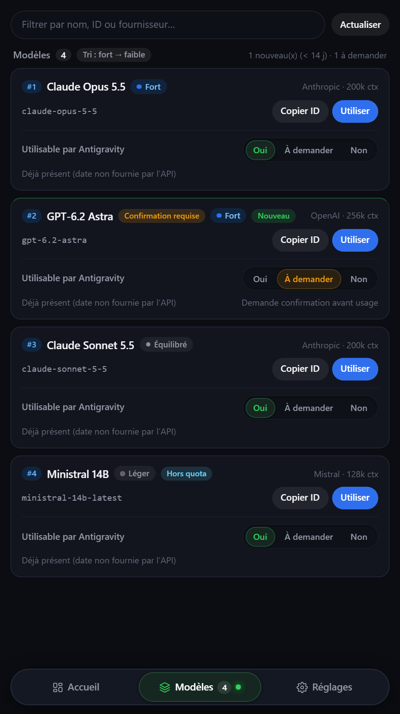
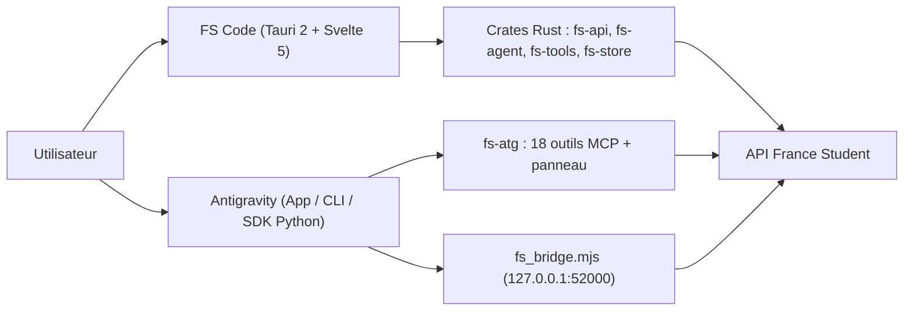

<div align="center">
  <picture>
    <source media="(prefers-color-scheme: dark)" srcset="v4/v4_blanc.svg" />
    <source media="(prefers-color-scheme: light)" srcset="v4/v4_bleu_transparent.png" />
    
  </picture>

  <h1>France Student Desktop &amp; Antigravity Bridge</h1>

  <p>
    Deux façons d'utiliser <strong>France Student</strong> (<code>ia.francestudent.org</code>) pour coder :<br />
    <strong>FS Code</strong>, une application bureau Tauri 2 · Rust · Svelte 5, et
    <strong><code>fs-atg</code> v2.6.0</strong>, un plugin pour Antigravity qui délègue le travail à France Student pour économiser le quota Antigravity.
  </p>

  <p>
    
    
    
    
    
  </p>
</div>

> [!NOTE]
> **Projet non officiel.** Les fonctions d'IA demandent une connexion Internet et un compte France Student valide. Ce dépôt ne contient aucun serveur France Student, ni secret, ni jeton d'authentification.

---

## Sommaire

1. [Aperçu visuel](#aperçu-visuel)
2. [Vue d'ensemble](#vue-densemble)
3. [FS Code (application bureau)](#fs-code-application-bureau)
4. [Plugin Antigravity `fs-atg`](#plugin-antigravity-fs-atg)
5. [Démos natif vs extension](#démos-natif-vs-extension)
6. [Installation](#installation)
7. [Sécurité et stockage local](#sécurité-et-stockage-local)
8. [Organisation du dépôt](#organisation-du-dépôt)
9. [Licence](#licence)

---

## Aperçu visuel

### FS Code

<div align="center">
  
</div>

### Panneau `fs-atg` dans Antigravity

<table>
  <tr>
    <td align="center" width="33%">
      <br />
      <sub><strong>Accueil</strong> : jauge budget, routage, composeur, historique</sub>
    </td>
    <td align="center" width="33%">
      <br />
      <sub><strong>Modèles</strong> : rang de puissance, badge <code>Hors quota</code>, règles Oui / À demander / Non</sub>
    </td>
    <td align="center" width="33%">
      <br />
      <sub><strong>Réglages</strong> : session, coupe-circuit, <em>Interface épurée</em>, <em>Effet Liquid Glass</em></sub>
    </td>
  </tr>
</table>

---

## Vue d'ensemble

| Volet | Dossier | Rôle |
|---|---|---|
| **FS Code** | [`app/`](app/) + [`crates/`](crates/) | IDE desktop autonome : agent, outils locaux, terminal, pont MCP |
| **`fs-atg`** | [`plugins/fs-atg/`](plugins/fs-atg/README.md) | Plugin Antigravity : serveur MCP, panneau latéral, agent natif, bridge local |
| **Démos** | dossiers à la racine | Comparatifs entre génération native Antigravity et délégation via `fs-atg` |

Les deux volets parlent à la même API France Student (`https://api.francestudent.ai`, connexion web via `https://ia.francestudent.org`).



---

## FS Code (application bureau)

### Crates Rust ([`crates/`](crates/))

Workspace Cargo (`Cargo.toml` : `members = ["crates/*", "app/src-tauri"]`, version `0.1.0`, édition 2021).

| Crate | Rôle |
|---|---|
| `fs-api` | Client HTTP et streaming SSE (`reqwest`, `eventsource-stream`), catalogue des routes documentées (`routes.rs`) |
| `fs-agent` | Boucle d'agent (`loop.rs`), politique et approbations (`policy.rs`, `approval.rs`), protocole d'outils client (`protocol.rs`, `tools.rs`), persistance (`store.rs`) |
| `fs-tools` | Outils locaux confinés au dossier de travail : `list_directory`, `read_file`, `search_files`, `edit_file`, `write_file`, `run_command` |
| `fs-store` | Réglages dans `config.json`, clé API dans le coffre du système (`keyring`) |

### Backend Tauri 2 ([`app/src-tauri/src/`](app/src-tauri/src/))

- **Agent et garde-fous** : `agent.rs`, `jobguard.rs`, `perm.rs`, `changelog.rs` (une ligne JSON par action dans `changes.jsonl`).
- **Connexion** : `login.rs`, flux web Auth.js sur `ia.francestudent.org`, session conservée dans `session.json`, ou jeton manuel via `keyring`.
- **Terminal et extensions** : `term.rs`, `mcp.rs` (compactage automatique des descriptions et JSON Schemas MCP pour économiser les tokens de contexte), `mcp_ctx.rs`, `ext.rs`, `skills.rs`, `plugins.rs`. `Extensions.svelte` intègre un compteur de budget contexte MCP et un catalogue vérifié regroupé en **Vidéo, Image, 3D & Audio** (`HyperFrames`, `FFmpeg Vidéo local`, `Kinocut` filtré, `YouTube Transcript`, `Blender 3D`, `Excalidraw`, `Mermaid SVG/PNG`, `Figma`, `ComfyUI`, `Hugging Face Spaces`, `Replicate`, `ElevenLabs`), **Boost IA & Dev** (`Playwright`, `Context7`, `Fichiers`, `Mémoire`, `Sequential Thinking`, `MarkItDown`, `Windows UIA`, `Serena LSP`, `Fetch`, `Git`) et **Apps essentielles** (`GitHub officiel`, `Google Calendar`, `Gmail + Calendar + Drive`, `Mail IMAP/SMTP`).
- **Pont MCP** : `bridge.rs` (`bridge_start`, `bridge_stop`, `bridge_status`, `bridge_confirm_answer`), démarrage auto désactivé par défaut (`auto_start: false`), arrêt propre sur `ExitRequested`, tunnel `cloudflared` récupéré par `app/scripts/fetch-cloudflared.mjs`.
- **Instructions du compte** : `instructions.rs`.

### Interface Svelte 5 ([`app/src/`](app/src/))

- Barre de titre (`TitleBar.svelte`), barre latérale repliable avec recherche, épinglés, archivés et projets (`Sidebar.svelte`), menu d'agents (`AgentMenu.svelte`), anneau de contexte (`ContextRing.svelte`).
- Diffs (`DiffPanel.svelte`, `DiffView.svelte`), terminal multi-onglets (`Terminal.svelte`), vues `Bridge`, `Plugins`, `Extensions`, `Settings`, `DevConsole`.
- Design plat et mat : aucun `backdrop-filter` ni flou dans `app/src/`.

### État du projet

- **En place** : workspace Rust multi-crates, câblage Tauri (`agent`, `bridge`, `instructions`, `plugins`, `term`, `mcp`), téléchargement automatique de `cloudflared`.
- **À finaliser** : gestion complète multipart/ZIP pour fichiers et skills, parcours OAuth MCP guidé et passkeys WebAuthn, bannières de reprise et de file d'attente, tests complets de l'installateur NSIS.
- **Manquant pour le bundle NSIS** : `app/src-tauri/tauri.conf.json` référence `binaries/CLOUDFLARED_NOTICE.txt`, absent de `app/src-tauri/binaries/` (qui ne contient que `cloudflared-x86_64-pc-windows-gnu.exe`).

---

## Plugin Antigravity `fs-atg`

Version **2.6.0**. Guide complet : [`plugins/fs-atg/README.md`](plugins/fs-atg/README.md).

`fs-atg` confie l'exploration, l'édition de code, le raisonnement, les artifacts visuels et le pilotage du bureau Windows à France Student. Antigravity reste le chef d'orchestre, France Student fait le travail lourd.

### Routage intelligent par spécialité et économie Opus

- **Le bon modèle selon la tâche et les forces Claude vs GPT (même en `MAX` / `Fort`)** : `fs_core.mjs` (`pickModel`) classe `gpt-6.2-sol`, `gpt-6.1-sol`, `gpt-6-sol` et `gpt-6.1-terra` en palier **`medium`** (équilibré) et évite d'appeler `claude-opus-5-5` en continu :
  - **Recherche code/web simple, Q/R, résumé, typo, doc courte** → modèle léger (`gpt-6-luna` / `claude-haiku-5-5`, effort `standard`).
  - **Backend, scripts, SQL, données, tests, correctifs courants** → OpenAI équilibré (`gpt-6.2-sol`, effort `deep`).
  - **UI / Frontend / CSS / Canvas / rédaction de documentation** → Anthropic équilibré (`claude-sonnet-5-5`).
  - **Vision Live / Computer Use** → `gpt-6.1-terra`.
  - **Algorithmes complexes, concurrence, maths** → OpenAI fort (`gpt-6.2-astra`, effort `max`).
  - **Architecture multi-fichiers lourde / sécurité critique** → Anthropic fort (`claude-opus-5-5`), uniquement si le budget restant est ≥ 30 % (`opusEconomyGuard`), sinon repli vers `gpt-6.2-astra` (sauf `/opus`, `/heavy` ou `/model`).
- **Repli borné par palier** (`pickFallbackModel`) : un échec ou refus sur un modèle léger ou équilibré bascule d'abord vers l'autre fournisseur du même palier (`gpt-6.2-sol` ↔ `claude-sonnet-5-5`) et ne saute jamais d'un modèle léger vers Opus.
- **Règle par modèle** :
  - `Oui` : sélection automatique autorisée.
  - `À demander` : le job passe en `needs_approval`, validation en un clic dans le panneau ou via `approveModel="..."`.
  - `Non` : blocage absolu (`assertModelNotDenied`), même en repli ou via `/model`.

### Garde budget à 0 %

- Les modèles de la famille Mistral (`mistral`, `ministral`, `codestral`, `devstral`, `pixtral`, `magistral`) sont **hors quota** et ignorent la réserve (`cutoffPercent`, 15 % par défaut).
- À **0 %**, sous la réserve, ou sur `429 CHAT_BUDGET_EXHAUSTED`, `fs-atg` bascule uniquement vers Mistral, sans jamais retenter un modèle à quota. Si aucun Mistral n'est autorisé, l'erreur est explicite.
- **Isolation de session** : un modèle sans `clientTools` ne réutilise pas le chat persistant du projet et repasse en mode texte/patch.
- **Filtrage `webSearch`** : si un modèle hors quota échoue avec la recherche web, un seul nouvel essai sans recherche sur ce même modèle.

### Agent natif et bridge local

- **Agent principal `france-student`** ([`agents/france-student.md`](plugins/fs-atg/agents/france-student.md)) : sélectionnable dans Antigravity App, et via `/agents` dans Antigravity CLI. Il appelle `fs_delegate` tout de suite, suit le job avec `fs_job_status`, demande ton accord avant tout `needs_approval` et repasse en natif pendant un cooldown `IA non dispo`.
- **Bridge local** ([`fs_bridge.mjs`](plugins/fs-atg/fs_bridge.mjs)) sur `http://127.0.0.1:52000` (variables `FS_BRIDGE_HOST` / `FS_BRIDGE_PORT`) :
  - API **Gemini** (`generateContent`, `streamGenerateContent`) et **OpenAI** (`POST /v1/chat/completions`), avec appels d'outils natifs.
  - Modèles virtuels `fs-auto`, `fs-quality`, `fs-max`, `fs-eco`, `fs-hors-quota`, routés sur le dernier tour `User:` de la conversation.
  - Configuration du `/model` d'Antigravity CLI via `node fs_bridge.mjs --print-cli-config` (`customModelsConfig`), et SDK Python via `LocalOpenAIAgentConfig`.

> [!IMPORTANT]
> **Limite d'Antigravity App** : son *Model Picker* graphique n'accepte pas de modèles personnalisés. Les modèles du bridge ne marchent donc que dans Antigravity CLI et le SDK Python. Dans l'App, choisis l'agent principal `france-student`.

### Outils de travail

| Capacité | Fichier | Ce que ça fait |
|---|---|---|
| **Computer Use + UIA** | [`computer_use.mjs`](plugins/fs-atg/computer_use.mjs) | Multi-écrans (`screen_info`, `screenshot`), arbre Windows UI Automation (`ui_tree`, `ui_click`), fenêtres, souris, clavier, presse-papiers |
| **Web Fetch** | [`web_fetch.mjs`](plugins/fs-atg/web_fetch.mjs) | Lecture HTTP(S) publique avec garde SSRF et conversion HTML → Markdown (`fs_fetch`) |
| **Docs Office/PDF** | [`doc_tools.mjs`](plugins/fs-atg/doc_tools.mjs) | Lecture Markdown/CSV/HTML, `.docx`/`.pptx`/`.xlsx` natifs Windows et PDF si extracteur présent (`fs_doc_read`) |
| **Git lecture seule** | [`git_tools.mjs`](plugins/fs-atg/git_tools.mjs) | Inspection `status`, `diff`, `log`, `branch`, `show` sans shell (`fs_git`) |
| **Média, Image & Vidéo** | [`media_tools.mjs`](plugins/fs-atg/media_tools.mjs) | Infos & édition image natives Windows (resize/crop/rotate/convert), export SVG→PNG, vidéo FFmpeg et rendu HTML→MP4 **HyperFrames** (`fs_media`) |
| **Vision Live** | `fs_delegate` (`liveComputerMode`) | Capture envoyée via `POST /filesv2`, France Student analyse et demande l'action suivante, en boucle jusqu'à la fin |
| **Sequential Thinking** | [`thinking_tools.mjs`](plugins/fs-atg/thinking_tools.mjs) | Étapes numérotées, révisions, branches, persistées dans `.fsatg_thinking.json` |
| **Canvas Live** | [`canvas_tools.mjs`](plugins/fs-atg/canvas_tools.mjs) | Artifacts **HTML, SVG ou Mermaid** servis sur une URL locale de prévisualisation |
| **Mémoire projet** | [`memory_store.mjs`](plugins/fs-atg/memory_store.mjs) | Notes, faits appris et pré-prompt dans `.fsatg_memory/` (un JSON par workspace + `profile.json`), lecture en plus de `FRST.md` / `FRSTCLI.md` |
| **`/undo` atomique** | [`tools_engine.mjs`](plugins/fs-atg/tools_engine.mjs) | Sauvegarde avant chaque écriture, restauration via `fs_undo` |

### Panneau latéral

- Rendu **Liquid Glass par défaut** (verre dépoli et pilule élastique, basculable en mat épuré), dock d'onglets en bas : `Accueil`, `Modèles`, `Réglages`.
- Dans **Réglages** : mode **Interface épurée**, interrupteur **Effet Liquid Glass**, et quatre interrupteurs d'extensions (`Computer Use`, `Raisonnement approfondi`, `Canvas Live`, `Média & Vidéo`).
- Jauges budget et contexte, bouton **`Live`**, historique de **50 tâches** avec titres lisibles par outil, télémétrie par modèle (tok/s, TTFT, taux de succès, badge `Instable`).
- Connexion via Chrome ou Edge en profil persistant, identifiants migrés dans le Gestionnaire d'identification Windows.

### Les 18 outils MCP

| Outil | Rôle |
|---|---|
| `fs_delegate` | Délègue une tâche (routage adaptatif, modes `generate` / `apply` / `plan` / `patch` / `dry-run`, Plan B, Vision Live) |
| `fs_job_status` | Attend et renvoie l'état d'un job (`waitSeconds` jusqu'à 180) |
| `fs_undo` | Liste les sauvegardes ou annule la dernière écriture |
| `fs_memory` | Notes, faits et pré-prompt du projet (`/remember`) |
| `fs_canvas` | Artifacts HTML, SVG, Mermaid |
| `fs_computer` | Pilotage bureau Windows + arbre UI Automation (`ui_tree`, `ui_click`) |
| `fs_thinking` | Raisonnement pas à pas (`think`, `history`, `status`, `clear`) |
| `fs_fetch` | Récupération HTTP(S) publique SSRF-safe + conversion HTML → Markdown |
| `fs_doc_read` | Lecture de docs Office (`.docx`, `.pptx`, `.xlsx` natifs Windows), CSV, HTML, Markdown et PDF |
| `fs_git` | Inspection Git lecture seule (`status`, `diff`, `log`, `branch`, `show`) |
| `fs_media` | Outil média unifié : infos/édition images natives Windows, export SVG→PNG, vidéo FFmpeg et rendu HTML→MP4 HyperFrames |
| `fs_logs` | Journal du connecteur, filtrable par gravité et par job |
| `fs_session` | État, compactage ou renouvellement de la session (`/compact`, `/new`) |
| `fs_quota` | Quota restant, heure de reset, seuil du coupe-circuit |
| `fs_diagnostics` | Vérification non destructive : identifiants, API, modèles, quota, erreurs récentes |
| `fs_status` | État du connecteur sans appel fournisseur : version, mode, outils, créneaux, cooldown, jobs |
| `fs_catalog` | Lecture seule : `/models`, `/metrics/chat-streams` et, selon le compte, `/skills`, `/projects`, `/mcp/servers`, `/filesv2` |
| `fs_cancel` | Annule un job en file ou en cours |

**11 skills actifs** (dossiers avec `SKILL.md` dans [`skills/`](plugins/fs-atg/skills/)) : `canvas`, `computer`, `eco`, `fs`, `max`, `patch`, `plan`, `quota`, `remember`, `think`, `undo`.

---

## Démos natif vs extension

Applications web autonomes qui comparent une génération **native Antigravity** et une délégation via **`fs-atg`**.

| Démo | Type | Contenu |
|---|---|---|
| [`chess-3d-native/`](chess-3d-native/index.html) vs [`chess-3d-ext/`](chess-3d-ext/index.html) | Échecs 3D (Three.js) | Jeu complet mono-fichier, pièces Staunton |
| [`chess-2d-native/`](chess-2d-native/index.html) vs [`chess-2d-ext/`](chess-2d-ext/index.html) | Échecs 2D (HTML) | Même jeu en 2D |
| [`calculator-3d-native/`](calculator-3d-native/index.html) vs [`calculator-3d-ext/`](calculator-3d-ext/index.html) | Calculatrice 3D | Style, interactions et coût en tokens |
| [`airplane-3d-game/`](airplane-3d-game/index.html) | Jeu 3D *Skyline Run* | Vol arcade (`index.html`, `main.js`, `style.css`) |
| [`coca-cola-showcase/`](coca-cola-showcase/index.html) | Vitrine 3D et audio | Scène Three.js + `audio.js`, lancement via [`Lancer Coca-Cola Experience.bat`](Lancer%20Coca-Cola%20Experience.bat) |

---

## Installation

### FS Code (Windows)

**Prérequis** : Node.js + npm, Rust stable + Cargo, WebView2, chaîne de build C++ compatible avec la cible Rust (le `cloudflared` fourni cible `x86_64-pc-windows-gnu`).

```powershell
cd app
npm ci
npm run build
npm run tauri -- dev
```

`npm run build` est nécessaire car Tauri attend `app/dist`. Vérifications Rust depuis la racine :

```powershell
cargo check --workspace
cargo test --workspace
```

Pour un build NSIS (`npm run tauri -- build --bundles nsis`), ajoute d'abord `CLOUDFLARED_NOTICE.txt` dans `app/src-tauri/binaries/`.

### Plugin `fs-atg`

```powershell
Copy-Item -Recurse -Force plugins\fs-atg "$env:USERPROFILE\.gemini\config\plugins\fs-atg"
cd "$env:USERPROFILE\.gemini\config\plugins\fs-atg"
npm install
```

Seule la racine du plugin a des dépendances npm. Ensuite :

1. Dans `mcp_config.json`, remplace `C:/Users/<USER>/...` par ton vrai chemin utilisateur.
2. Active le plugin `fs-atg` dans Antigravity.
3. Ouvre le panneau **France Student [ATG]** et connecte-toi (navigateur ou clé API).

Bridge optionnel pour Antigravity CLI : `node fs_bridge.mjs`, puis `node fs_bridge.mjs --print-cli-config` pour obtenir la configuration du `/model`.

---

## Sécurité et stockage local

- **FS Code** : réglages dans `config.json`, session web dans `session.json`, journal d'actions dans `changes.jsonl`, jetons manuels dans le coffre système (`keyring`). Ne commite jamais `session.json`, `.env` ni tes cookies.
- **`fs-atg`** : clé API et jeton de session migrés dans le **Gestionnaire d'identification Windows** (`credential_store.mjs`, `windows_credential_store.ps1`). Les fichiers d'état locaux (`.fs*`), les profils navigateur et `node_modules/` sont exclus par `.gitignore`.

---

## Organisation du dépôt

```text
.
├── app/                          # FS Code : interface Svelte 5 + backend Tauri 2 (app/src-tauri)
├── crates/                       # Crates Rust : fs-api, fs-agent, fs-tools, fs-store
├── plugins/
│   └── fs-atg/                   # Plugin Antigravity v2.6.0 (MCP, panneau, agent, skills, bridge)
├── assets/screenshots/           # Captures d'écran du README
├── v4/                           # Logos France Student
├── chess-3d-native/              # Démo échecs 3D (natif)
├── chess-3d-ext/                 # Démo échecs 3D (fs-atg)
├── chess-2d-native/              # Démo échecs 2D (natif)
├── chess-2d-ext/                 # Démo échecs 2D (fs-atg)
├── calculator-3d-native/         # Démo calculatrice 3D (natif)
├── calculator-3d-ext/            # Démo calculatrice 3D (fs-atg)
├── airplane-3d-game/             # Jeu 3D Skyline Run
├── coca-cola-showcase/           # Vitrine 3D et audio
├── cyber-runner/                 # Vide pour l'instant
├── flight-sim-3d/                # Vide pour l'instant
├── neon-drift-3d/                # Vide pour l'instant
├── Lancer Coca-Cola Experience.bat
├── Cargo.toml                    # Workspace Rust
├── client-tools.md               # Spécification des clientTools
├── instruction.md                # Notes / instructions
├── PROJET.md, Plan.md            # Notes de conception historiques
├── Fait.md, Prochaine_etape.md   # Journaux de suivi historiques
└── LICENSE                       # Apache License 2.0
```

---

## Licence

Sous licence **Apache License 2.0**, voir [`LICENSE`](LICENSE).
Les marques, logos et services **France Student** restent la propriété de leurs titulaires respectifs.
