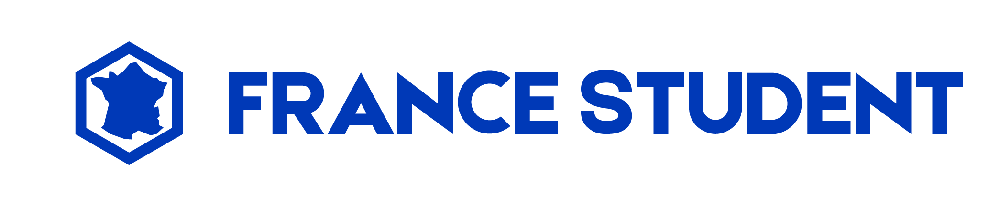
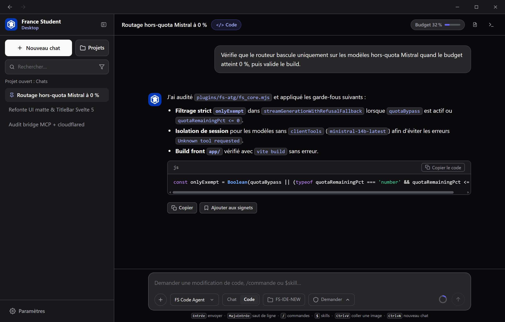
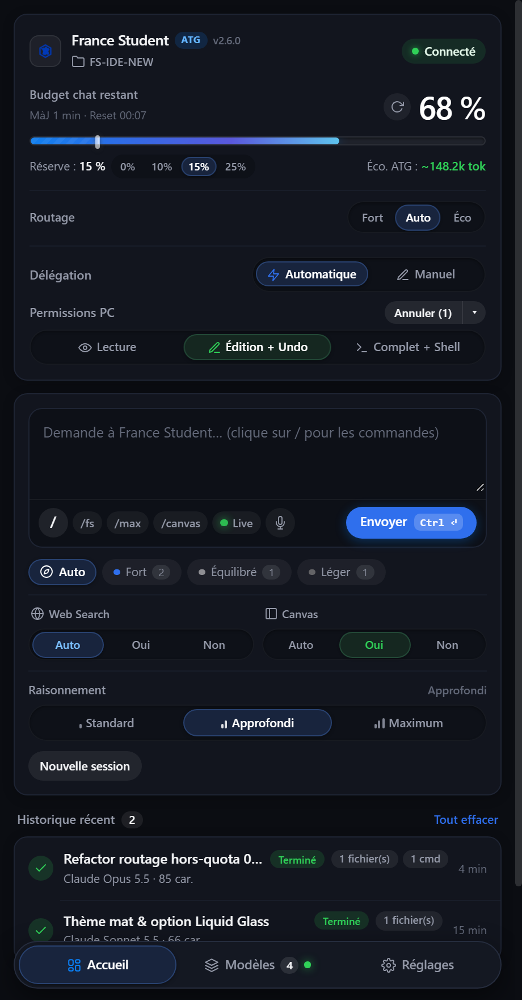
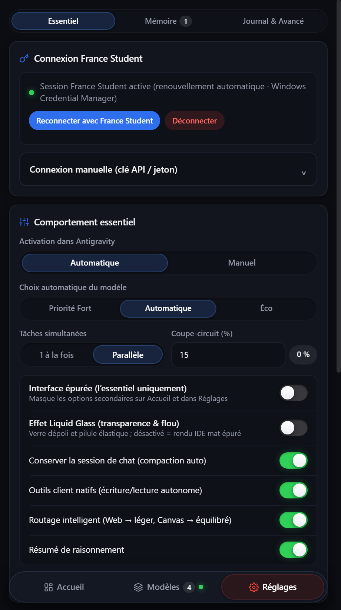
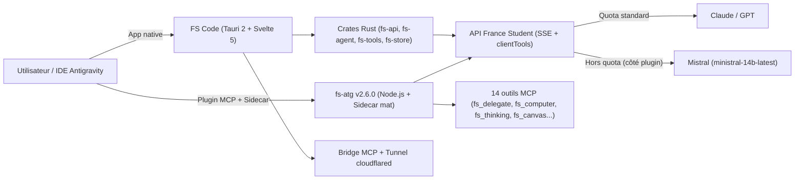

<div align="center">
  <picture>
    <source media="(prefers-color-scheme: dark)" srcset="v4/v4_blanc.svg" />
    <source media="(prefers-color-scheme: light)" srcset="v4/v4_bleu_transparent.png" />
    
  </picture>

  <h1>France Student Desktop &amp; Antigravity Bridge</h1>

  <p>
    <strong>Écosystème autour de France Student (<code>ia.francestudent.org</code>)</strong> :<br />
    Application bureau <strong>FS Code</strong> (Tauri 2 · Rust · Svelte 5), plugin orchestrateur <strong><code>fs-atg</code> v2.6.0</strong> pour Antigravity (MCP + Sidecar + agent principal natif <code>france-student</code> + bridge Gemini/OpenAI + Computer Use + bascule hors-quota Mistral à 0 %), et galerie de démos 3D/2D.
  </p>

  <p>
    
    
    
    
    
  </p>
</div>

> [!NOTE]
> **Projet non officiel.** Une connexion Internet et un compte France Student valide sont requis pour les fonctions d'IA. Ce dépôt ne contient aucun serveur de France Student et n'inclut aucun secret ni jeton d'authentification.

---

## Sommaire

1. [Captures d'écran](#captures-décran)
2. [Dernières évolutions](#dernières-évolutions)
3. [Architecture globale](#architecture-globale)
4. [Revue de l'existant : France Student Desktop (FS Code)](#revue-de-lexistant--france-student-desktop-fs-code)
5. [Plugin Antigravity `fs-atg` v2.6.0](#plugin-antigravity-fs-atg-v260)
6. [Démos & Comparatifs Natif vs Extension](#démos--comparatifs-natif-vs-extension)
7. [Installation & Démarrage rapide](#installation--démarrage-rapide)
8. [Sécurité & Stockage local](#sécurité--stockage-local)
9. [Organisation du dépôt](#organisation-du-dépôt)
10. [Licence](#licence)

---

## Captures d'écran

### Application bureau FS Code (`app/`)

<div align="center">
  
</div>

### Panneau latéral Antigravity `fs-atg` (`plugins/fs-atg/sidecars/fs_atg_panel/`)

<table>
  <tr>
    <td align="center" width="33%">
      <br />
      <sub><strong>Accueil</strong> — Jauge budget, routage, composeur et historique</sub>
    </td>
    <td align="center" width="33%">
      <br />
      <sub><strong>Modèles</strong> — Score de puissance, <code>Hors quota</code> et règles Oui / À demander / Non</sub>
    </td>
    <td align="center" width="33%">
      <br />
      <sub><strong>Réglages</strong> — Session, coupe-circuit, <em>Interface épurée</em> et option <em>Liquid Glass</em></sub>
    </td>
  </tr>
</table>

---

## Dernières évolutions

| Domaine | Évolution |
|---|---|
| **Interface** | Rendu **mat et épuré par défaut**, sans transparence ni `backdrop-filter`, sur l'application desktop (`app/`) et le panneau `fs-atg` : surfaces opaques hiérarchisées et bordures fines nettes. Dans les **Réglages** du panneau : interrupteur optionnel **Effet Liquid Glass** (désactivé par défaut) et mode **Interface épurée**. |
| **Budget 0 %** | Protection stricte côté plugin : à 0 % (ou sous la réserve `cutoffPercent`), routage direct vers les modèles **hors-quota Mistral** uniquement, sans recherche ni repli vers un modèle à quota. Isolation de session pour les modèles sans `clientTools` et filtrage `webSearch` ciblé (un seul nouvel essai sans recherche web sur le même modèle hors-quota). |
| **Agent natif** | Agent principal **`france-student`** ([`agents/france-student.md`](plugins/fs-atg/agents/france-student.md)), sélectionnable dans Antigravity App et via `/agents` dans Antigravity CLI : délégation directe `fs_delegate`, commandes `/fs`, `/max`, `/plan`, `/patch`, `/eco`, `/undo`, `/remember`, `/quota`, `/canvas`, `/computer`, `/think`, gestion de `needs_approval` et bascule native pendant un cooldown `IA non dispo`. |
| **Routage intelligent (y compris en MAX)** | Même quand `MAX` / `Fort` est actif, [`fs_core.mjs`](plugins/fs-atg/fs_core.mjs) (`pickModel`) rétrograde automatiquement le texte simple, les questions/réponses et les typos vers un modèle léger (effort `standard`), et le code standard court vers un modèle équilibré (effort `deep`). Les paliers `heavy` + effort `max` restent réservés à l'ingénierie complexe, aux profils `security` / `refactor` ou à un palier forcé (`/heavy`, `/model`). [`fs_bridge.mjs`](plugins/fs-atg/fs_bridge.mjs) applique la même logique sur le **dernier tour `User:`** de la conversation. La règle est aussi imposée à l'agent natif dans [`agents/france-student.md`](plugins/fs-atg/agents/france-student.md). Le réglage d'état `smartRouting` permet de la désactiver. |
| **Bridge local** | [`fs_bridge.mjs`](plugins/fs-atg/fs_bridge.mjs) expose France Student en **Gemini API** et **OpenAI Chat Completions** sur `http://127.0.0.1:52000` : modèles virtuels pour le `/model` d'Antigravity CLI (`customModelsConfig`, via `node fs_bridge.mjs --print-cli-config`) et le SDK Python (`LocalOpenAIAgentConfig`). |

> [!IMPORTANT]
> **Limite officielle d'Antigravity App** : son *Model Picker* graphique n'accepte pas de modèles personnalisés. Les modèles du bridge ne sont utilisables que dans Antigravity CLI et le SDK Python. Dans l'App, sélectionne l'agent principal `france-student`.

---

## Architecture globale

Le dépôt rassemble **trois volets complémentaires** construits autour de l'API France Student (`https://api.francestudent.ai` / `https://ia.francestudent.org`) :



---

## Revue de l'existant : France Student Desktop (`FS Code`)

L'application principale (`app/` + `crates/`) regroupe les briques cœur de l'IDE desktop :

### Crates Rust du workspace (`crates/`)

| Crate | Rôle dans l'architecture |
|---|---|
| `fs-api` | Client HTTP & streaming SSE (`reqwest`, `eventsource-stream`), catalogue des routes documentées (`routes.rs`), gestion projets/chats/tokens |
| `fs-agent` | Boucle d'agent autonome (`loop.rs`), gestion de politique/approbation (`policy.rs`, `approval.rs`), protocole d'outils client (`protocol.rs`, `tools.rs`) et persistance d'exécution (`store.rs`) |
| `fs-tools` | Exécution locale confinée au dossier de travail (`list_directory`, `read_file`, `search_files`, `edit_file`, `write_file`, `run_command`) |
| `fs-store` | Persistance locale des réglages, sessions et préférences (`config.json`, `keyring` système) |

### Backend Tauri 2 (`app/src-tauri/src/`) — Modules branchés dans `main.rs`

L'ensemble des modules principaux est câblé dans `app/src-tauri/src/main.rs` :

- **Boucle agent & garde d'exécution** : `agent.rs`, `jobguard.rs`, `perm.rs`, `changelog.rs` (journalisation des écritures et commandes).
- **Authentification** : `login.rs` (flux web Auth.js `ia.francestudent.org` -> cookie session -> renouvellement de jeton court, ou jeton manuel via `keyring`).
- **Terminal & Extensions** : `term.rs` (multi-onglets), `mcp.rs`, `mcp_ctx.rs`, `ext.rs`, `skills.rs`, `plugins.rs` (gestionnaire de plugins intégré).
- **Pont MCP & Instructions compte** : `bridge.rs` (`bridge_start`, `bridge_stop`, `bridge_status`, `bridge_confirm_answer`, démarrage automatique optionnel avec `auto_start: false` par défaut et arrêt propre à `ExitRequested`, avec `cloudflared` géré par `app/scripts/fetch-cloudflared.mjs`) et `instructions.rs` (synchronisation automatique des instructions personnalisées côté compte).

### Interface Svelte 5 (`app/src/`)

- Barre de titre personnalisée (`TitleBar.svelte`), barre latérale repliable (`Sidebar.svelte`) avec recherche/épinglage/archivage/projets, sélecteur d'agents (`AgentMenu.svelte`), anneau de contexte (`ContextRing.svelte`), inspecteur de diffs (`DiffPanel.svelte` / `DiffView.svelte`), terminal multi-onglets (`Terminal.svelte` + `termstore.svelte.js`), et vues dédiées (`Bridge.svelte`, `Plugins.svelte`, `Extensions.svelte`, `Settings.svelte`, `DevConsole.svelte`).
- Design plat et mat : `app/src/` n'utilise plus aucun flou (`backdrop-filter`) ni transparence sur ses barres et panneaux.

### Points en place vs reste à finaliser sur FS Code

- **En place** : workspace Rust multi-crates (`crates/*` + `app/src-tauri`), câblage Tauri (`bridge`, `instructions`, `plugins`, `agent`, `term`, `mcp`), scripts de vérification navigation et téléchargement `cloudflared`.
- **Encore partiel / à valider** : gestion complète multipart/ZIP pour fichiers et skills, parcours OAuth MCP guidé / passkeys WebAuthn, bannières de reprise/file d'attente, et tests complets de l'installateur NSIS. `binaries/CLOUDFLARED_NOTICE.txt` est référencé par `app/src-tauri/tauri.conf.json` mais **absent** de `app/src-tauri/binaries/` (qui ne contient que `cloudflared-x86_64-pc-windows-gnu.exe`) : à ajouter avant le bundle NSIS.

---

## Plugin Antigravity `fs-atg` v2.6.0

Situé dans [`plugins/fs-atg/`](plugins/fs-atg/README.md), ce plugin transforme **France Student** en **orchestrateur autonome pour Antigravity** afin d'économiser le quota Antigravity et de piloter code, écran et réflexion directement depuis le panneau latéral.

### Fonctionnalités principales

1. **Interface Sidecar mate par défaut (+ option *Liquid Glass*)** ([`index.html`](plugins/fs-atg/sidecars/fs_atg_panel/index.html))
   - Barre d'onglets ancrée en bas (`Accueil`, `Modèles`, `Réglages`) avec indicateur glissant opaque net sur fond mat par défaut (sans flou ni transparence), et interrupteur **Effet Liquid Glass** dans **Réglages** pour retrouver le verre dépoli (`backdrop-filter: blur`) et la pilule élastique si souhaité.
   - Jauges de budget chat et contexte, bouton **`Live`** (Computer Use), et, dans **Réglages**, un bloc « Extensions MCP actives » avec 3 interrupteurs intégrés (`Computer Use`, `Raisonnement approfondi`, `Canvas Live`) qui activent `fs_computer`, `fs_thinking` et `fs_canvas` dans `fs-atg`, plus un historique étendu à **50 tâches** avec boutons d'action directs.

2. **Contrôle strict par modèle (`Oui` / `À demander` / `Non`) & Classement auto** ([`fs_core.mjs`](plugins/fs-atg/fs_core.mjs))
   - Classement universel du plus fort au plus faible (`#1`, score de puissance, télémétrie `tok/s`, `TTFT`, taux de succès, badge **`Instable`**).
   - **`Oui`** : sélection et secours automatiques autorisés.
   - **`À demander`** : bloque l'appel, passe le job en `needs_approval` et affiche la validation en 1 clic dans le panneau ou via `approveModel="..."`.
   - **`Non`** : blocage absolu (`assertModelNotDenied`), même en cascade de repli ou via `/model`.

3. **Mistral Hors Quota (`Hors quota`)**
   - Les modèles Mistral (`ministral-14b-latest`, `mistral*`, `codestral*`, `devstral*`, `pixtral*`, `magistral*`) **contournent les quotas locaux et la réserve (`cutoffPercent`)**.
   - À **`0 %` de budget**, sous la réserve, ou dès qu'un modèle Claude/GPT renvoie `429 CHAT_BUDGET_EXHAUSTED`, `fs-atg` exclut les modèles soumis au quota et bascule sur Mistral (sans jamais re-tenter un modèle à quota), avec isolation de session pour les modèles sans `clientTools`.
   - Badge **`Hors quota`** dans l'onglet Modèles et mention sous la jauge.

4. **Computer Use Multi-Écrans & Boucle Vision Live** ([`computer_use.mjs`](plugins/fs-atg/computer_use.mjs))
   - Capture par écran (`screenIndex` / `deviceName` via `screen_info` + `screenshot`), gestion des fenêtres, souris, clavier et presse-papiers Windows.
   - Upload d'images via `POST /filesv2` et boucle itérative **Vision Live** (`liveComputerMode`) : Antigravity capture l'écran → France Student analyse et demande la prochaine action → Antigravity exécute et renvoie une nouvelle capture jusqu'à complétion.

5. **Raisonnement séquentiel, Canvas Live & Mémoire projet**
   - **`fs_thinking`** ([`thinking_tools.mjs`](plugins/fs-atg/thinking_tools.mjs)) : suivi structuré étape par étape persisté dans `.fsatg_thinking.json`.
   - **`fs_canvas`** ([`canvas_tools.mjs`](plugins/fs-atg/canvas_tools.mjs)) : création et prévisualisation live d'artifacts HTML / SVG / Mermaid.
   - **`fs_memory`** ([`memory_store.mjs`](plugins/fs-atg/memory_store.mjs)) : notes projet (`/remember`), faits appris et pré-prompt, persistés dans le dossier `.fsatg_memory/` (un fichier JSON par workspace + `profile.json`) et réinjectés au premier tour ; lit aussi en complément `FRST.md` / `FRSTCLI.md`. Les sauvegardes atomiques **`/undo`** sur les éditions disque relèvent de `fs_undo` ([`tools_engine.mjs`](plugins/fs-atg/tools_engine.mjs)), pas de `fs_memory`.

<details>
<summary><strong>Voir les 14 outils MCP exposés par <code>fs-atg</code></strong></summary>

| Outil MCP | Description |
|---|---|
| `fs_delegate` | Délégation intelligente (`Fort`, `Auto`, `Éco`) avec routage adaptatif (texte simple → modèle léger, même en MAX), écriture workspace `/undo`, Plan B et Vision Live |
| `fs_job_status` | Suivi d'avancement, pensées, fichiers modifiés et validations `needs_approval` |
| `fs_undo` | Annulation atomique de modifications de fichiers |
| `fs_memory` | Lecture/écriture de la mémoire projet persistante |
| `fs_canvas` | Création et rendu d'artifacts interactifs |
| `fs_computer` | Pilotage bureau Windows multi-écrans (souris, clavier, fenêtres, captures) |
| `fs_thinking` | Raisonnement pas-à-pas avec hypothèses, révisions et branches |
| `fs_logs` | Journaux filtrables du connecteur |
| `fs_session` | Gestion / réinitialisation des sessions France Student |
| `fs_quota` | Budget restant, réserve et cooldown `IA non dispo` |
| `fs_diagnostics` | État auth, connectivité, catalogue et télémétrie modèles |
| `fs_status` | Statut du connecteur sans appel fournisseur : transport MCP, version, mode Auto/Manuel, outils publiés, créneaux de stream, cooldown global, jobs actifs/en file et erreurs récentes (les métriques de streaming côté API sont dans `fs_catalog`, ressource `streams`) |
| `fs_catalog` | Consultation lecture seule : `GET /models`, `/metrics/chat-streams` et, selon disponibilité côté compte, `/skills`, `/projects`, `/mcp/servers`, `/filesv2` |
| `fs_cancel` | Annulation d'un job actif |

</details>

---

## Démos & Comparatifs Natif vs Extension

Plusieurs applications web autonomes ont été incluses à la racine du dépôt pour comparer une génération **Native Antigravity** et une délégation **Extension `fs-atg`** :

| Projet | Type | Ce qui est comparé / démontré |
|---|---|---|
| [`chess-3d-native/`](chess-3d-native/index.html) vs [`chess-3d-ext/`](chess-3d-ext/index.html) | Échecs 3D (Three.js) | Jeu d'échecs 3D complet mono-fichier (plateau 3D, logique complète ; pièces Staunton dans `chess-3d-ext`) : natif vs délégué via `fs-atg` |
| [`chess-2d-native/`](chess-2d-native/index.html) vs [`chess-2d-ext/`](chess-2d-ext/index.html) | Échecs 2D (HTML) | Comparatif 2D natif vs extension `fs-atg` |
| [`calculator-3d-native/`](calculator-3d-native/index.html) vs [`calculator-3d-ext/`](calculator-3d-ext/index.html) | Calculatrice 3D (HTML/CSS) | Calculatrice 3D interactive comparant style, physique UI et coût tokens |
| [`airplane-3d-game/`](airplane-3d-game/index.html) | Jeu 3D WebGL (`Skyline Run`) | Jeu de vol arcade 3D modulaire (`index.html`, `main.js`, `style.css`) |
| [`coca-cola-showcase/`](coca-cola-showcase/index.html) | Vitrine 3D & Audio (`Coca-Cola Red Experience`) | Scène 3D interactive + synthèse audio dédiée (`audio.js`), lançable via [`Lancer Coca-Cola Experience.bat`](Lancer%20Coca-Cola%20Experience.bat) |

---

## Installation & Démarrage rapide

### 1. Application desktop `FS Code` (Windows)

**Prérequis** : Node.js + npm, Rust stable + Cargo, WebView2 et chaîne de build C++ compatible avec la cible Rust choisie (le binaire `cloudflared` présent dans `app/src-tauri/binaries/` cible `x86_64-pc-windows-gnu`).

```powershell
# 1. Installer les dépendances front et construire app/dist (requis par Tauri)
cd app
npm ci
npm run build

# 2. Lancer en mode développement (Vite + Tauri)
npm run tauri -- dev
```

Pour un build NSIS (`npm run tauri -- build --bundles nsis`), `app/src-tauri/tauri.conf.json` référence également `binaries/CLOUDFLARED_NOTICE.txt` (à ajouter dans `app/src-tauri/binaries/` avant empaquetage).

Vérifications depuis la racine (après `npm run build` dans `app/`) :

```powershell
cargo check --workspace
cargo test --workspace
```

### 2. Plugin Antigravity `fs-atg` v2.6.0

Voir le guide détaillé dans [`plugins/fs-atg/README.md`](plugins/fs-atg/README.md) :

```powershell
# Copier dans le dossier des plugins Antigravity puis installer les dépendances Node
Copy-Item -Recurse -Force plugins\fs-atg "$env:USERPROFILE\.gemini\config\plugins\fs-atg"
cd "$env:USERPROFILE\.gemini\config\plugins\fs-atg"
npm install
```

Important : remplace ensuite `C:/Users/<USER>/...` dans `mcp_config.json` par ton chemin utilisateur Windows réel, puis connecte ton compte depuis l'onglet **Accueil** ou **Réglages**.

---

## Sécurité & Stockage local

- **FS Code** stocke la configuration dans `config.json`, la session web dans `session.json`, les journaux d'actions dans `changes.jsonl` et les jetons manuels dans le coffre-fort système (`keyring`). **Ne commitez jamais `session.json`, `.env`, ni vos cookies.**
- **Plugin `fs-atg`** migre automatiquement la clé API et le jeton de session web dans le **Gestionnaire d'identification Windows** (`credential_store.mjs` / `windows_credential_store.ps1`). Les fichiers d'état locaux (`.fs*`), profils navigateur et `node_modules/` sont exclus par `.gitignore`.

---

## Organisation du dépôt

```text
FranceStudent_Desktop/
├── app/                     # Interface Svelte 5 + backend Tauri 2 (app/src-tauri)
├── assets/
│   └── screenshots/         # Captures d'écran de FS Code et du panneau fs-atg
├── crates/                  # Workspace Rust (fs-api, fs-agent, fs-tools, fs-store)
├── plugins/
│   └── fs-atg/              # Plugin Antigravity v2.6.0 (MCP + Sidecar + Agents + Skills + Bridge)
├── chess-3d-native/         # Démo Échecs 3D (Natif Antigravity)
├── chess-3d-ext/            # Démo Échecs 3D (Extension fs-atg)
├── chess-2d-native/         # Démo Échecs 2D (Natif Antigravity)
├── chess-2d-ext/            # Démo Échecs 2D (Extension fs-atg)
├── calculator-3d-native/    # Démo Calculatrice 3D (Natif Antigravity)
├── calculator-3d-ext/       # Démo Calculatrice 3D (Extension fs-atg)
├── airplane-3d-game/        # Jeu 3D Skyline Run
├── coca-cola-showcase/      # Expérience 3D & Audio
├── cyber-runner/            # Dossier présent mais vide pour l'instant (aucune démo)
├── flight-sim-3d/           # Dossier présent mais vide pour l'instant (aucune démo)
├── neon-drift-3d/           # Dossier présent mais vide pour l'instant (aucune démo)
├── Lancer Coca-Cola Experience.bat
├── v4/                      # Ressources graphiques et logos France Student
├── Cargo.toml               # Workspace Rust
├── client-tools.md          # Spécification des clientTools
├── instruction.md           # Notes / instructions
├── PROJET.md / Plan.md      # Notes de conception internes (historiques, non garanties à jour)
├── Fait.md / Prochaine_etape.md  # Journaux de suivi historiques internes (peuvent citer d'anciens fichiers)
└── LICENSE                  # Apache License 2.0
```

---

## Licence

Sous licence **Apache License 2.0** — voir [`LICENSE`](LICENSE).  
Les marques, logos et services **France Student** restent la propriété de leurs titulaires respectifs.
