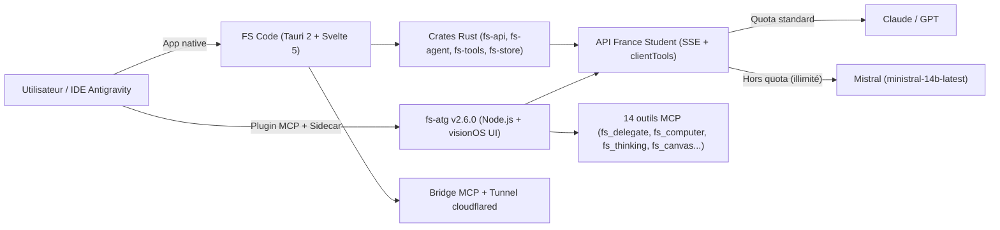

<div align="center">
  <picture>
    <source media="(prefers-color-scheme: dark)" srcset="v4/v4_blanc.svg" />
    <source media="(prefers-color-scheme: light)" srcset="v4/v4_bleu_transparent.png" />
    
  </picture>

  <h1>France Student Desktop &amp; Antigravity Bridge</h1>

  <p>
    <strong>Suite complète autour de France Student (<code>ia.francestudent.org</code>)</strong> :<br />
    Application bureau <strong>FS Code</strong> (Tauri 2 · Rust · Svelte 5), plugin orchestrateur <strong><code>fs-atg</code> v2.6.0</strong> pour Antigravity (MCP + Sidecar visionOS + Computer Use + Mistral Hors Quota), et galerie de démos 3D/2D.
  </p>

  <p>
    
    
    
    
    
  </p>
</div>

> [!NOTE]
> **Projet non officiel.** Une connexion Internet et un compte France Student valide sont requis pour les fonctions d'IA. Ce dépôt ne contient aucun serveur de France Student et n'inclut aucun secret ni jeton d'authentification.

---

## Sommaire

1. [Architecture globale](#-architecture-globale)
2. [Revue de l'existant : France Student Desktop (FS Code)](#-revue-de-lexistant--france-student-desktop-fs-code)
3. [Nouveautés : Plugin Antigravity `fs-atg` v2.6.0](#-nouveautés--plugin-antigravity-fs-atg-v260)
4. [Démos & Comparatifs Natif vs Extension](#-démos--comparatifs-natif-vs-extension)
5. [Installation & Démarrage rapide](#-installation--démarrage-rapide)
6. [Sécurité & Stockage local](#-sécurité--stockage-local)
7. [Organisation du dépôt](#-organisation-du-dépôt)
8. [Licence](#-licence)

---

## Architecture globale

Le dépôt rassemble **trois volets complémentaires** construits autour de l'API France Student (`https://api.francestudent.org`) :



---

## Revue de l'existant : France Student Desktop (`FS Code`)

L'application principale (`app/` + `crates/`) est déjà très avancée sur les briques cœur de l'IDE desktop :

### Crates Rust du workspace (`crates/`)

| Crate | Rôle dans l'architecture |
|---|---|
| `fs-api` | Client HTTP & streaming SSE (`reqwest`, `eventsource-stream`), catalogue des routes documentées (`routes.rs`), gestion projets/chats/tokens |
| `fs-agent` | Boucle d'agent autonome (`loop.rs`), gestion de politique/approbation (`policy.rs`, `approval.rs`), protocole d'outils client (`protocol.rs`, `tools.rs`) et persistance d'exécution (`store.rs`) |
| `fs-tools` | Exécution locale confinée au dossier de travail (`list_directory`, `read_file`, `search_files`, `edit_file`, `write_file`, `run_command`) |
| `fs-store` | Persistance locale des réglages, sessions et préférences (`config.json`, `keyring` système) |

### Backend Tauri 2 (`app/src-tauri/src/`) — Modules branchés dans `main.rs`

Contrairement aux notes d'étapes intermédiaires dans [`Prochaine_etape.md`](Prochaine_etape.md) et [`Fait.md`](Fait.md), l'état réel du code montre que l'ensemble des modules principaux **est déjà câblé** dans `app/src-tauri/src/main.rs` :

- **Boucle agent & garde d'exécution** : `agent.rs`, `jobguard.rs`, `perm.rs`, `changelog.rs` (journalisation des écritures et commandes).
- **Authentification** : `login.rs` (flux web Auth.js `ia.francestudent.org` -> cookie session -> renouvellement de jeton court, ou jeton manuel via `keyring`).
- **Terminal & Extensions** : `term.rs` (multi-onglets), `mcp.rs`, `mcp_ctx.rs`, `ext.rs`, `skills.rs`, `plugins.rs` (gestionnaire de plugins intégré).
- **Pont MCP & Instructions compte** : `bridge.rs` (`bridge_start`, `bridge_stop`, `bridge_status`, `bridge_confirm_answer`, autostart au lancement et arrêt propre à `ExitRequested`, avec `cloudflared` géré par `app/scripts/fetch-cloudflared.mjs`) et `instructions.rs` (synchronisation automatique des instructions personnalisées côté compte).

### Interface Svelte 5 (`app/src/`)

- Barre de titre personnalisée (`TitleBar.svelte`), barre latérale repliable (`Sidebar.svelte`) avec recherche/épinglage/archivage/projets, sélecteur d'agents (`AgentMenu.svelte`), anneau de contexte (`ContextRing.svelte`), inspecteur de diffs (`DiffPanel.svelte` / `DiffView.svelte`), terminal multi-onglets (`Terminal.svelte` + `termstore.svelte.js`), et vues dédiées (`Bridge.svelte`, `Plugins.svelte`, `Extensions.svelte`, `Settings.svelte`, `DevConsole.svelte`).

### Points déjà solides vs reste à valider sur FS Code

- **Déjà en place** : workspace Rust multi-crates compilable, câblage Tauri complet (`bridge`, `instructions`, `plugins`, `agent`, `term`, `mcp`), scripts de navigation et téléchargement `cloudflared`.
- **Encore partiel / à tester manuellement** (cf. [`Fait.md`](Fait.md)) : gestion complète multipart/ZIP pour fichiers et skills, parcours OAuth MCP guidé / passkeys WebAuthn, bannières de reprise/file d'attente et tests complets d'installation via le bundle NSIS.

---

## Nouveautés : Plugin Antigravity `fs-atg` v2.6.0

Situé dans [`plugins/fs-atg/`](plugins/fs-atg/README.md), ce plugin transforme **France Student** en **orchestrateur autonome pour Antigravity** afin d'économiser le quota Antigravity et de piloter code, écran et réflexion directement depuis le panneau latéral.

### Ce qui a été conçu et vérifié

1. **Interface Sidecar style visionOS / Dynamic Island** ([`index.html`](plugins/fs-atg/sidecars/fs_atg_panel/index.html))
   - Barre d'onglets flottante ancrée en bas (`Accueil`, `Modèles`, `Réglages`) avec pilule verre dépoli **Liquid Spring Pill** (`getBoundingClientRect` + rebond ressort + reflet spéculaire + teinte contextuelle par onglet et sur tous les contrôles segmentés).
   - Jauges épurées (budget chat + contexte persistant), bouton **`Live`** (Computer Use), extensions MCP dynamiques (`3 / 3 actives`) et historique étendu à **50 tâches** avec boutons d'action directs.

2. **Contrôle strict par modèle (`Oui` / `À demander` / `Non`) & Classement auto** ([`fs_core.mjs`](plugins/fs-atg/fs_core.mjs))
   - Classement universel du plus fort au plus faible (`#1`, score de puissance, télémétrie `tok/s`, `TTFT`, taux de succès, badge **`Instable`**).
   - **`Oui`** : sélection et secours automatiques autorisés.
   - **`À demander`** : bloque l'appel, passe le job en `needs_approval` et affiche la validation en 1 clic dans le panneau ou via `approveModel="..."`.
   - **`Non`** : blocage absolu (`assertModelNotDenied`), même en cascade de repli ou via `/model`.

3. **Mistral Hors Quota (`Hors quota`)**
   - Les modèles Mistral (`ministral-14b-latest`, `mistral*`, `codestral*`, `devstral*`, `pixtral*`, `magistral*`) **passent outre les quotas et la réserve (`cutoffPercent`)**.
   - À **`0 %` de budget**, sous la réserve, ou dès qu'un modèle Claude/GPT renvoie `429 CHAT_BUDGET_EXHAUSTED`, `fs-atg` saute immédiatement les modèles soumis au quota et bascule sur Mistral avec repli propre en mode texte/patch si l'endpoint ne supporte pas `clientTools`.
   - Badge **`Hors quota`** dans l'onglet Modèles et mention sous la jauge.

4. **Computer Use Multi-Écrans & Boucle Vision Live** ([`computer_use.mjs`](plugins/fs-atg/computer_use.mjs))
   - Capture par écran (`screenIndex` / `deviceName` via `screen_info` + `screenshot`), gestion des fenêtres, souris, clavier et presse-papiers Windows.
   - Upload d'images via `POST /filesv2` et boucle itérative **Vision Live** (`liveComputerMode`): Antigravity capture l'écran → France Student analyse et demande la prochaine action → Antigravity exécute et renvoie une nouvelle capture jusqu'à complétion.

5. **Raisonnement séquentiel, Canvas Live & Mémoire projet**
   - **`fs_thinking`** ([`thinking_tools.mjs`](plugins/fs-atg/thinking_tools.mjs)) : suivi structuré étape par étape persisté dans `.fsatg_thinking.json`.
   - **`fs_canvas`** ([`canvas_tools.mjs`](plugins/fs-atg/canvas_tools.mjs)) : création et prévisualisation live d'artifacts HTML / SVG / Mermaid / 3D.
   - **`fs_memory`** ([`memory_store.mjs`](plugins/fs-atg/memory_store.mjs)) : mémoire projet `FRST.md` / `FRSTCLI.md` réinjectée au premier tour, avec sauvegarde atomique **`/undo`** sur toutes les éditions disque.

<details>
<summary><strong>Voir les 14 outils MCP exposés par <code>fs-atg</code></strong></summary>

| Outil MCP | Description |
|---|---|
| `fs_delegate` | Délégation intelligente (`Fort`, `Auto`, `Éco`), écriture workspace `/undo`, Plan B et Vision Live |
| `fs_job_status` | Suivi d'avancement, pensées, fichiers modifiés et validations `needs_approval` |
| `fs_undo` | Annulation atomique de modifications de fichiers |
| `fs_memory` | Lecture/écriture de la mémoire projet persistante |
| `fs_canvas` | Création et rendu d'artifacts interactifs |
| `fs_computer` | Pilotage bureau Windows multi-écrans (souris, clavier, fenêtres, captures) |
| `fs_thinking` | Raisonnement pas-à-pas avec hypothèses, révisions et branches |
| `fs_logs` | Journaux filtrables du connecteur |
| `fs_session` | Gestion / réinitialisation des sessions France Student |
| `fs_quota` | Budget restant, réserve et cooldown `IA non dispo` |
| `fs_diagnostics` | État auth, connectivité, catalogue et télémétrie modèles |
| `fs_status` | Statut global du connecteur et des créneaux de streaming |
| `fs_catalog` | Consultation lecture seule (`/skills`, `/projects`, `/mcp/servers`, `/filesv2`) |
| `fs_cancel` | Annulation d'un job actif |

</details>

---

## Démos & Comparatifs Natif vs Extension

Pour comparer concrètement la qualité de rendu et la consommation Antigravity (`/usage`) entre une exécution **Native Antigravity** et une délégation **Extension `fs-atg`**, plusieurs applications autonomes ont été incluses à la racine du dépôt :

| Projet | Type | Ce qui est comparé / démontré |
|---|---|---|
| [`chess-3d-native/`](chess-3d-native/index.html) vs [`chess-3d-ext/`](chess-3d-ext/index.html) | Échecs 3D (Three.js) | Jeu d'échecs 3D complet mono-fichier (pièces Staunton, plateau 3D, logique complète) : généré en natif vs délégué via `fs-atg` |
| [`chess-2d-native/`](chess-2d-native/index.html) vs [`chess-2d-ext/`](chess-2d-ext/index.html) | Échecs 2D (HTML) | Comparatif 2D natif vs extension `fs-atg` |
| [`calculator-3d-native/`](calculator-3d-native/index.html) vs [`calculator-3d-ext/`](calculator-3d-ext/index.html) | Calculatrice 3D (HTML/CSS) | Calculatrice 3D interactive comparant style, physique UI et coût tokens |
| [`airplane-3d-game/`](airplane-3d-game/index.html) | Jeu 3D WebGL (`Skyline Run`) | Jeu de vol arcade 3D modulaire (`index.html`, `main.js`, `style.css`) |
| [`coca-cola-showcase/`](coca-cola-showcase/index.html) | Vitrine 3D & Audio (`Coca-Cola Red Experience`) | Scène 3D interactive + synthèse audio dédiée (`audio.js`), lançable via [`Lancer Coca-Cola Experience.bat`](Lancer%20Coca-Cola%20Experience.bat) |

---

## Installation & Démarrage rapide

### 1. Application desktop `FS Code` (Windows)

**Prérequis** : Node.js + npm, Rust stable + Cargo, outils de build C++ Visual Studio et WebView2.

```powershell
# Installer les dépendances front (télécharge aussi cloudflared)
cd app
npm ci

# Lancer en mode développement (Vite + Tauri)
npm run tauri -- dev

# Ou compiler l'installateur NSIS Windows
npm run tauri -- build --bundles nsis
```

Vérifications workspace depuis la racine :

```powershell
cargo check
cargo test --workspace
```

### 2. Plugin Antigravity `fs-atg` v2.6.0

Voir le guide détaillé dans [`plugins/fs-atg/README.md`](plugins/fs-atg/README.md) :

```powershell
# Copier dans le dossier des plugins Antigravity puis installer les dépendances Node
Copy-Item -Recurse -Force plugins\fs-atg "$env:USERPROFILE\.gemini\config\plugins\fs-atg"
cd "$env:USERPROFILE\.gemini\config\plugins\fs-atg"
npm install
cd sidecars\fs_atg_panel
npm install
```

Adapter ensuite `mcp_config.json` avec votre chemin utilisateur local et connecter votre compte depuis l'onglet **Accueil** ou **Réglages**.

---

## Sécurité & Stockage local

- **FS Code** stocke la configuration dans `config.json`, la session web dans `session.json`, les journaux d'actions dans `changes.jsonl` et les jetons manuels dans le coffre-fort système (`keyring`). **Ne commitez jamais `session.json`, `.env`, ni vos cookies.**
- **Plugin `fs-atg`** migre automatiquement la clé API et le jeton de session web dans le **Gestionnaire d'identification Windows** (`credential_store.mjs` / `windows_credential_store.ps1`). Les fichiers d'état locaux (`.fs*`), profils navigateur et `node_modules/` sont exclus par `.gitignore`.

---

## Organisation du dépôt

```text
FranceStudent_Desktop/
├── app/                     # Interface Svelte 5 + backend Tauri 2 (app/src-tauri)
├── crates/                  # Workspace Rust (fs-api, fs-agent, fs-tools, fs-store)
├── plugins/
│   └── fs-atg/              # Plugin Antigravity v2.6.0 (MCP + Sidecar visionOS + Skills)
├── chess-3d-native/         # Démo Échecs 3D (Natif Antigravity)
├── chess-3d-ext/            # Démo Échecs 3D (Extension fs-atg)
├── chess-2d-native/         # Démo Échecs 2D (Natif Antigravity)
├── chess-2d-ext/            # Démo Échecs 2D (Extension fs-atg)
├── calculator-3d-native/    # Démo Calculatrice 3D (Natif Antigravity)
├── calculator-3d-ext/       # Démo Calculatrice 3D (Extension fs-atg)
├── airplane-3d-game/        # Jeu 3D Skyline Run
├── coca-cola-showcase/      # Expérience 3D & Audio (+ Lancer Coca-Cola Experience.bat)
├── v4/                      # Ressources graphiques et logos France Student
├── API_FranceStudent.md     # (ignoré localement si présent) / client-tools.md
├── Cargo.toml               # Workspace Rust
├── PROJET.md / Plan.md      # Architecture et notes de conception
├── Fait.md / Prochaine_etape.md
└── LICENSE                  # Apache License 2.0
```

---

## Licence

Sous licence **Apache License 2.0** — voir [`LICENSE`](LICENSE).  
Les marques, logos et services **France Student** restent la propriété de leurs titulaires respectifs.
