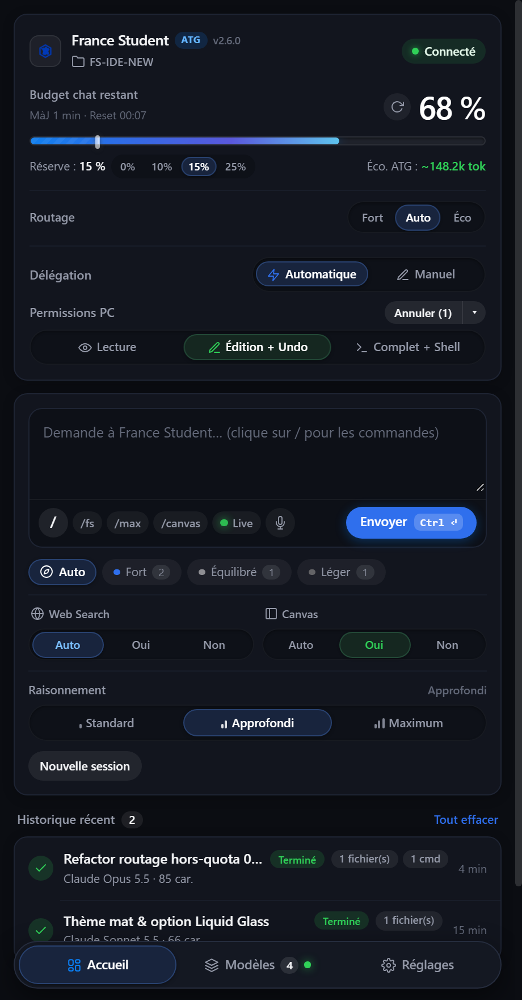
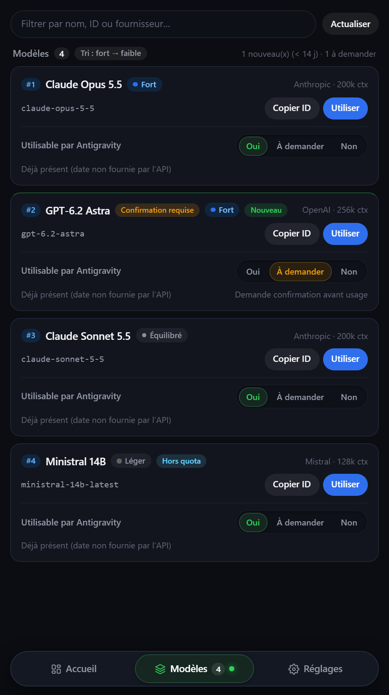
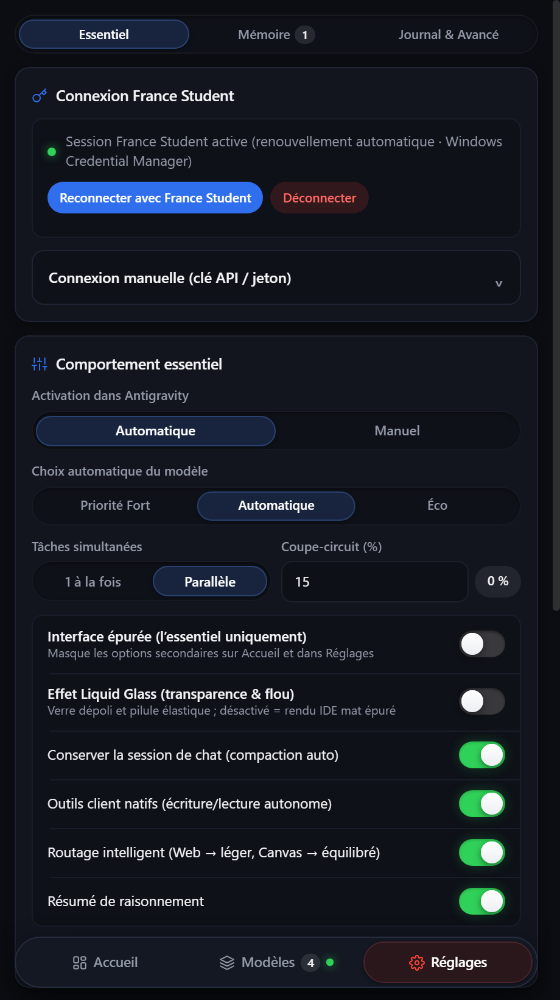

# France Student [ATG] (`fs-atg` v2.6.0)

Orchestrateur **France Student** complet pour **Antigravity** (Serveur MCP + Sidecar HTML/Node.js à rendu *Liquid Glass* par défaut, avec option mat épuré).

Il délègue l’exploration, la planification, l’édition atomique de code (`/undo`), le raisonnement approfondi, la création d’artifacts Canvas, le pilotage bureau Windows (*Computer Use* + boucle Vision Live) et les recherches web directement aux modèles France Student afin d’économiser le quota Antigravity.

<div align="center">
  
  
  
</div>

---

## Nouveautés majeures (v2.6.0)

- **Dock bas & Effet Liquid Glass par défaut (+ option mat épuré)** : verre dépoli (`backdrop-filter: blur`) et pilule élastique actifs par défaut, avec un interrupteur **Effet Liquid Glass** dans **Réglages** pour basculer vers un rendu IDE mat épuré à tout moment.
- **Interface épurée** : l’interrupteur **Interface épurée** des **Réglages** masque les éléments secondaires pour ne garder que l’essentiel.
- **Routage intelligent par spécialité (même en mode `MAX` / `Fort`) & Économie Opus** : `fs_core.mjs` classe `gpt-6.2-sol` / `gpt-6.1-sol` / `gpt-6-sol` / `gpt-6.1-terra` en `medium` (équilibré) et répartit chaque demande selon ses points forts :
  - **Recherche simple, Q/R, résumé, typo, doc courte** → léger (`gpt-6-luna` / `claude-haiku-5-5`, effort `standard`) — jamais Opus ;
  - **Backend, SQL, scripts, tests, debug standard** → `gpt-6.2-sol` ;
  - **UI / Frontend / CSS / Canvas / refonte doc** → `claude-sonnet-5-5` ;
  - **Vision Live / Computer Use** → `gpt-6.1-terra` ;
  - **Algorithmes complexes, concurrence, maths** → `gpt-6.2-astra` ;
  - **Architecture multi-fichiers lourde / sécurité critique** → `claude-opus-5-5` (réservé aux gros chantiers, évité sous `30 %` de budget via `opusEconomyGuard`, sauf `/opus` ou `/heavy`). Le repli en cas d'erreur (`pickFallbackModel`) reste borné au palier (un échec en `light` ne saute jamais vers Opus). `fs_bridge.mjs` applique la même logique sur le dernier tour `User:` (+ détection d'images), et `agents/france-student.md` impose la règle à l'agent natif.
- **Agent principal natif Antigravity (`agents/france-student.md`)** : sélectionnable directement comme agent principal dans Antigravity App et `/agents` dans Antigravity CLI (`model: flash` côté enveloppe Antigravity, délégation complète vers France Student). Workflow complet : `fs_delegate` immédiat avec `workspaceRoot` + `contextMode="minimal"`, suivi via `fs_job_status`, pas de relecture des fichiers listés dans `filesWritten`, commandes `/fs`, `/max`, `/plan`, `/patch`, `/eco`, `/undo`, `/remember`, `/quota`, `/canvas`, `/computer`, `/think`, accord explicite avant tout `needs_approval`, et bascule native transparente pendant un cooldown `IA non dispo`.
- **Bridge local Gemini API & OpenAI (`fs_bridge.mjs`)** : expose France Student sur `http://127.0.0.1:52000` avec appels d’outils natifs (`functionDeclarations` ↔ `functionCall` / `tool_calls`) et respect strict du hors-quota à `0 %`, compatible avec le **`/model` picker natif d’Antigravity CLI** (`customModelsConfig`, via `node fs_bridge.mjs --print-cli-config`) et le **SDK Python Antigravity** (`LocalOpenAIAgentConfig`).
  > **Limite officielle** : le Model Picker graphique d’Antigravity App n’accepte pas de modèles personnalisés. Les modèles virtuels du bridge (`fs-auto`, `fs-quality`, `fs-max`, `fs-eco`, `fs-hors-quota`) ne sont donc utilisables que dans Antigravity CLI et le SDK Python. Dans l’App, passe par l’agent principal `france-student`.
- **Contrôle strict par modèle (`Oui` / `À demander` / `Non`)** :
  - `Oui` : sélection automatique autorisée ;
  - `À demander` : bloque l’exécution et retourne `status: "needs_approval"` avec approbation en 1 clic dans le panneau ou `approveModel="..."` ;
  - `Non` : interdiction absolue (`assertModelNotDenied`), même en secours ou en alias explicite.
- **Mistral hors quota (`Hors quota`)** : les modèles Mistral (`ministral-14b-latest`, `mistral*`, `codestral*`, `devstral*`, `pixtral*`, `magistral*`) passent outre les quotas locaux et la réserve (`cutoffPercent`). En cas de budget à `0 %`, sous réserve, ou sur `429 CHAT_BUDGET_EXHAUSTED`, bascule automatique vers Mistral (avec repli propre en mode texte/patch si `clientTools` n’est pas supporté par le endpoint).
  - **Protection stricte à 0 %** : aucune recherche ni repli vers un modèle à quota. Si aucun Mistral n’est autorisé, l’erreur est explicite (pas de tentative silencieuse).
  - **Isolation de session** : un modèle sans `clientTools` ne réutilise pas le chat persistant du projet ; en cas d’historique d’outils incompatible, nouvel essai sur un chat neuf.
  - **Filtrage `webSearch`** : si un modèle hors-quota échoue avec la recherche web active, un seul nouvel essai sans recherche web sur ce même modèle.
- **Computer Use UIA & Vision Live (`Live`)** :
  - Multi-écrans (`screen_info`, `screenshot` avec `screenIndex` / `deviceName`), **Windows UI Automation (`ui_tree` lecture seule, `ui_click` par `name`/`automationId`)**, liste/focus des fenêtres, souris, clavier, presse-papiers.
  - Upload réel via `POST /filesv2` et attachement aux tours `/chats/stream` pour une boucle itérative Antigravity ↔ France Student (`liveComputerMode`).
- **Outils locaux zéro-dépendance (`fs_fetch`, `fs_doc_read`, `fs_git`, `fs_media`)** : lecture web HTML→Markdown protégée SSRF (`web_fetch.mjs`), extraction `.docx`/`.pptx`/`.xlsx`/CSV/HTML native Windows + PDF optionnel (`doc_tools.mjs`), inspection Git lecture seule (`git_tools.mjs`), et outil média unifié (`media_tools.mjs`) pour images natives Windows, export SVG→PNG, montage vidéo FFmpeg et rendu HTML→MP4 **HyperFrames**.
- **Raisonnement séquentiel (`fs_thinking`)** & **Canvas Live (`fs_canvas`)** : journal de pensée cross-processus (`.fsatg_thinking.json`) et prévisualisation HTML/SVG/Mermaid (une scène 3D reste possible en HTML via une bibliothèque JS).
- **Authentification robuste** : connexion web via navigateur **Chrome ou Microsoft Edge** en profil persistant (`browser_auth.mjs` via CDP) avec renouvellement automatique de session, migration sécurisée dans le **Gestionnaire d’identification Windows** (`windows_credential_store.ps1`), et clé API manuelle.
- **Historique étendu (50 tâches)**, télémétrie modèles (tok/s, TTFT, taux de succès, badge `Instable`), et suivi des économies de tokens Antigravity.

---

## Outils MCP exposés (`mcp_server.mjs`)

| Outil | Rôle |
|---|---|
| `fs_delegate` | Délègue une tâche avec routage intelligent (`Fort`, `Auto`, `Éco`), outils locaux `/undo`, Plan B et Vision Live |
| `fs_job_status` | Suivi temps réel d’un job (`waiting`, `running`, `needs_approval`, `done`, `failed`) |
| `fs_undo` | Annulation atomique de modifications disque |
| `fs_memory` | Lecture/écriture de la mémoire projet persistante (dossier `.fsatg_memory/` + lecture `FRST.md` / `FRSTCLI.md`) |
| `fs_canvas` | Création/prévisualisation d’artifacts HTML, SVG, Mermaid |
| `fs_computer` | Capture multi-écrans, Windows UIA (`ui_tree`, `ui_click`), fenêtres, souris, clavier, presse-papiers |
| `fs_thinking` | Raisonnement structuré étape par étape avec hypothèses et branches |
| `fs_fetch` | Lecture d’URLs publiques HTTP(S) (garde SSRF) et conversion HTML → Markdown |
| `fs_doc_read` | Lecture de docs Office (`.docx`, `.pptx`, `.xlsx` natifs), CSV, HTML, Markdown et PDF |
| `fs_git` | Inspection Git lecture seule (`status`, `diff`, `log`, `branch`, `show`) |
| `fs_media` | Outil média unifié : infos/édition images natives Windows, export SVG→PNG, montage vidéo FFmpeg et rendu HTML→MP4 HyperFrames |
| `fs_logs` | Consultation des journaux du connecteur |
| `fs_session` | Gestion et réinitialisation des sessions persistantes par projet |
| `fs_quota` | Lecture du budget restant, de l’heure de reset et du cooldown global |
| `fs_diagnostics` | Vérification auth, connectivité API, catalogue et télémétrie modèles |
| `fs_status` | Statut du connecteur sans appel fournisseur : transport MCP, version, mode Auto/Manuel, outils publiés, créneaux de stream, cooldown global et jobs actifs/en file |
| `fs_catalog` | Découverte lecture seule : `GET /models`, `/metrics/chat-streams` et, selon disponibilité côté compte, `/skills`, `/projects`, `/mcp/servers`, `/filesv2` |
| `fs_cancel` | Annulation d’un job en cours |

---

## Installation rapide (Antigravity)

1. Copier ce dossier dans `%USERPROFILE%\.gemini\config\plugins\fs-atg`.
2. Installer les dépendances Node.js à la racine du plugin (le sidecar `sidecars/fs_atg_panel` n'a aucune dépendance npm) :
   ```powershell
   cd "$env:USERPROFILE\.gemini\config\plugins\fs-atg"
   npm install
   ```
3. Remplacer impérativement `C:/Users/<USER>/...` dans `mcp_config.json` par votre chemin utilisateur local (ex. `C:/Users/prenom/.gemini/config/plugins/fs-atg/mcp_server.mjs`), puis activer le plugin `fs-atg` dans Antigravity.
4. Ouvrir le panneau **France Student [ATG]** et cliquer sur **Connexion navigateur** (ou coller votre clé / jeton).
